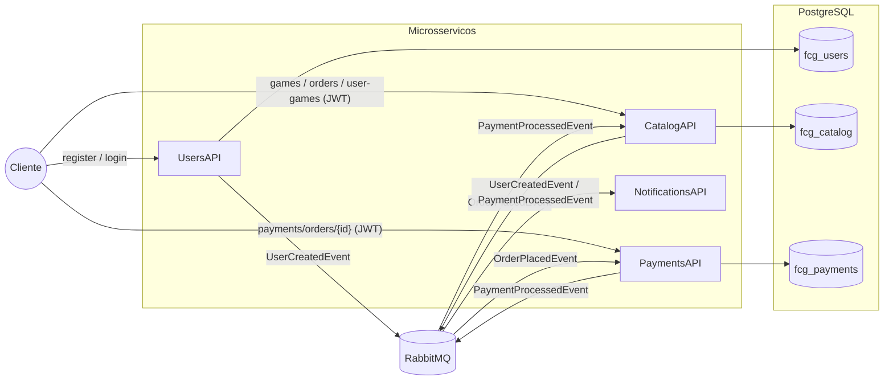
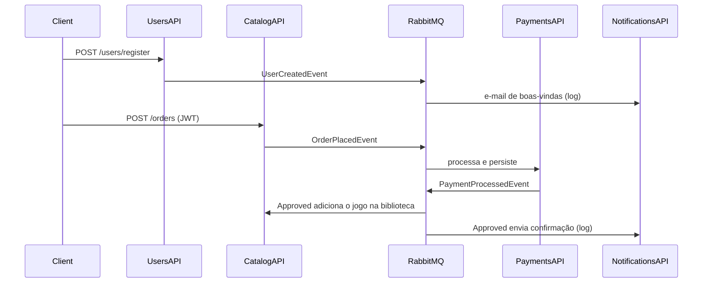

# FCG.Orchestration — FIAP Cloud Games, Fase 2

Repositório de orquestração da Fase 2 do Tech Challenge. A Fase 2 quebra o monolito da Fase 1 ([IseduardoRezende/FCG](https://github.com/IseduardoRezende/FCG)) em **4 microsserviços .NET 10** que se comunicam de forma **assíncrona por eventos** (RabbitMQ + MassTransit 8). Aqui ficam:

- o `docker-compose.yml`, que sobe o ecossistema inteiro (Postgres, RabbitMQ e os 4 serviços);
- os manifestos Kubernetes da infraestrutura (Postgres e RabbitMQ) e o `kustomization.yaml` que agrega os k8s dos 4 serviços;
- os scripts de deploy no Kind e de teste ponta a ponta;
- o template do relatório de entrega (`RELATORIO.txt`).

## Repositórios

| Repositório | Responsabilidade | Porta (compose) |
|-------------|------------------|-----------------|
| [FCG.UsersAPI](https://github.com/IseduardoRezende/FCG.UsersAPI) | Cadastro, login (JWT), roles. Publica `UserCreatedEvent` | 5101 |
| [FCG.CatalogAPI](https://github.com/IseduardoRezende/FCG.CatalogAPI) | Jogos, pedidos e biblioteca. Publica `OrderPlacedEvent` e consome `PaymentProcessedEvent` | 5102 |
| [FCG.PaymentsAPI](https://github.com/IseduardoRezende/FCG.PaymentsAPI) | Simula o pagamento. Consome `OrderPlacedEvent` e publica `PaymentProcessedEvent` | 5103 |
| [FCG.NotificationsAPI](https://github.com/IseduardoRezende/FCG.NotificationsAPI) | E-mails simulados (log). Consome `UserCreatedEvent` e `PaymentProcessedEvent` | 5104 |
| [FCG.Orchestration](https://github.com/IseduardoRezende/FCG.Orchestration) | Este repositório | — |

Cada serviço tem o próprio README (responsabilidade, estrutura, regras, endpoints, eventos, variáveis e testes), Dockerfile multi-stage, pasta `k8s/` e CI.

## Arquitetura



### Fluxos



### Decisões de design

- **Banco por serviço**: um PostgreSQL com três bancos (`fcg_users`, `fcg_catalog` e `fcg_payments`). Nenhum serviço lê o banco de outro.
- **Contratos de eventos**: os records ficam em `Contracts/Events.cs`, no namespace `FCG.Contracts.Events`. O arquivo é **idêntico em todos os repositórios**, porque o MassTransit roteia pelo nome completo do tipo. Copiar o arquivo mantém a autonomia de cada repositório, sem precisar de um pacote NuGet compartilhado.
- **Dados no evento**: o e-mail e o nome viajam nos eventos, então o Notifications é stateless e nenhum serviço chama outro por HTTP.
- **JWT compartilhado**: só o UsersAPI emite tokens. O Catalog e o Payments validam com a mesma chave (via Secret) e leem `sub`, `email` e `role` das claims.
- **Compra assíncrona**: `POST /orders` responde 202 com o pedido `Pending`. O resultado chega pelo evento e é consultado em `GET /orders/{id}`.
- **Pagamento simulado e determinístico**: o pagamento é `Approved` se `preço <= Payments:MaxApprovedAmount` (padrão 100,00). Isso permite demonstrar os dois caminhos.
- **Idempotência**: o Payments usa um índice único em `OrderId` e ignora pedidos repetidos. O Catalog só transiciona pedidos `Pending`, e a biblioteca tem índice único (usuário, jogo).
- **Resiliência**: retry do MassTransit (3 tentativas a cada 5s), `EnableRetryOnFailure` no EF Core e probes de readiness e liveness.
- **Limitação conhecida**: os eventos são publicados logo depois do `SaveChanges`, sem outbox transacional. Se o broker cair exatamente entre a gravação e a publicação, o evento se perde. Um outbox do MassTransit resolveria; ficou fora por simplicidade (KISS).

## Pré-requisitos

- Docker Desktop (com o Compose v2)
- Para Kubernetes: `kubectl` e [Kind](https://kind.sigs.k8s.io/) (ou o Kubernetes do Docker Desktop)
- .NET 10 SDK, só para rodar ou testar fora de containers

Clone os 5 repositórios **lado a lado**, na mesma pasta. O compose e o kustomization usam caminhos relativos (`../FCG.UsersAPI` etc.):

```powershell
mkdir FCG-Fase2; cd FCG-Fase2
"Orchestration","UsersAPI","CatalogAPI","PaymentsAPI","NotificationsAPI" | ForEach-Object { git clone "https://github.com/IseduardoRezende/FCG.$_.git" }
```

```
FCG-Fase2/
  FCG.Orchestration/
  FCG.UsersAPI/
  FCG.CatalogAPI/
  FCG.PaymentsAPI/
  FCG.NotificationsAPI/
```

## Docker Compose

```powershell
cd FCG.Orchestration
docker compose up -d --build
docker compose ps
```

| Recurso | Endereço |
|---------|----------|
| UsersAPI (Swagger) | http://localhost:5101/swagger |
| CatalogAPI (Swagger) | http://localhost:5102/swagger |
| PaymentsAPI (Swagger) | http://localhost:5103/swagger |
| NotificationsAPI (health) | http://localhost:5104/health |
| RabbitMQ Management | http://localhost:15672 (usuário `fcg`, senha `fcg`) |
| PostgreSQL | `localhost:5434`, usuário `postgres`, senha `postgres`, bancos `fcg_users`, `fcg_catalog` e `fcg_payments` |

- O script `postgres/init.sql` cria os bancos no primeiro start, e cada serviço aplica as próprias migrations no startup.
- Os serviços só sobem depois que o Postgres e o RabbitMQ estão saudáveis (`healthcheck` + `depends_on`).
- O limite de aprovação pode ser alterado sem rebuild: `$env:PAYMENTS_MAX_APPROVED_AMOUNT="50"; docker compose up -d payments-api`.
- Para ver os e-mails simulados: `docker compose logs -f notifications-api`.
- Para derrubar tudo: `docker compose down`. Para apagar também os dados: `docker compose down -v`.

## Kubernetes

Todos os recursos vão para o namespace `fcg`. Os serviços se encontram pelos nomes dos Services (`postgres`, `rabbitmq`, `fcg-users-api` etc.). As configurações ficam em ConfigMaps e as credenciais em Secrets.

```
k8s/
  namespace.yaml
  postgres/    configmap (init.sql), secret, deployment, service
  rabbitmq/    configmap, secret, deployment, service (5672 e 15672)
  kustomization.yaml   agrega postgres, rabbitmq e ../../FCG.*API/k8s
```

### Opção A: script (Kind)

```powershell
./scripts/kind-deploy.ps1
```

O script gera as imagens (`docker compose build`), cria o cluster `fcg` no Kind se ele ainda não existir, carrega as 4 imagens (`kind load docker-image`), aplica `kubectl apply -k k8s` e espera os rollouts.

### Opção B: passo a passo

```powershell
docker compose build
kind create cluster --name fcg
"users","catalog","payments","notifications" | ForEach-Object { kind load docker-image "fcg-$_-api:latest" --name fcg }
kubectl apply -k k8s
kubectl -n fcg get pods
```

No Kubernetes do Docker Desktop, as imagens locais já ficam visíveis (`imagePullPolicy: IfNotPresent`), então não é preciso rodar `kind load`.

Para aplicar sem o kustomize, rode `kubectl apply -f` em cada pasta (`k8s/namespace.yaml`, `k8s/postgres`, `k8s/rabbitmq` e o `k8s/` de cada serviço) usando `-n fcg`.

Resultado esperado:

```
NAME                                     READY   STATUS    RESTARTS
fcg-catalog-api-...                      1/1     Running   0..3
fcg-notifications-api-...                1/1     Running   0
fcg-payments-api-...                     1/1     Running   0..3
fcg-users-api-...                        1/1     Running   0..3
postgres-...                             1/1     Running   0
rabbitmq-...                             1/1     Running   0
```

Alguns restarts iniciais são esperados: os serviços sobem junto com o Postgres e o RabbitMQ e reiniciam até a infraestrutura ficar pronta.

### Acesso no cluster

```powershell
kubectl -n fcg port-forward svc/fcg-users-api 6101:80
kubectl -n fcg port-forward svc/fcg-catalog-api 6102:80
kubectl -n fcg port-forward svc/fcg-payments-api 6103:80
kubectl -n fcg port-forward svc/rabbitmq 15672:15672
kubectl -n fcg logs -f deploy/fcg-notifications-api
```

Para remover tudo: `kubectl delete -k k8s`, ou `kind delete cluster --name fcg`.

## Testando os fluxos

### Script automático

```powershell
./scripts/e2e-smoke.ps1                                          # Docker Compose
./scripts/e2e-smoke.ps1 -UsersUrl http://localhost:6101 -CatalogUrl http://localhost:6102 -PaymentsUrl http://localhost:6103   # Kubernetes via port-forward
```

O script cadastra um usuário, faz o login dele e do admin e cria um jogo de 59,90 e outro de 199,90. Depois compra os dois e espera os pedidos virarem `Approved` e `Rejected`, e confere a biblioteca e o pagamento.

### Manualmente (curl)

```bash
# 1) Cadastro (UserCreatedEvent gera a boas-vindas no log do Notifications)
curl -X POST http://localhost:5101/api/v1/users/register -H "Content-Type: application/json" \
  -d '{"name":"Player","email":"player@fcg.com","password":"Abcdef1!"}'

# 2) Login do usuário e do admin
curl -X POST http://localhost:5101/api/v1/users/logins -H "Content-Type: application/json" \
  -d '{"email":"player@fcg.com","password":"Abcdef1!"}'        # USER_TOKEN
curl -X POST http://localhost:5101/api/v1/users/logins -H "Content-Type: application/json" \
  -d '{"email":"fcg@admin.com","password":"Fcg@Admin2026!"}'   # ADMIN_TOKEN

# 3) O admin cria os jogos
curl -X POST http://localhost:5102/api/v1/games -H "Authorization: Bearer $ADMIN_TOKEN" -H "Content-Type: application/json" \
  -d '{"name":"Hollow Knight","description":"Metroidvania","price":59.90}'
curl -X POST http://localhost:5102/api/v1/games -H "Authorization: Bearer $ADMIN_TOKEN" -H "Content-Type: application/json" \
  -d '{"name":"Collector Edition","description":"Too expensive","price":199.90}'

# 4) Compra aprovada (59,90 <= 100,00): 202 Pending, que logo vira Approved
curl -X POST http://localhost:5102/api/v1/orders -H "Authorization: Bearer $USER_TOKEN" -H "Content-Type: application/json" -d '{"gameId":1}'
curl http://localhost:5102/api/v1/orders/1 -H "Authorization: Bearer $USER_TOKEN"
curl http://localhost:5102/api/v1/user-games -H "Authorization: Bearer $USER_TOKEN"

# 5) Compra rejeitada (199,90 > 100,00): o pedido vira Rejected e a biblioteca não muda
curl -X POST http://localhost:5102/api/v1/orders -H "Authorization: Bearer $USER_TOKEN" -H "Content-Type: application/json" -d '{"gameId":2}'
curl http://localhost:5102/api/v1/orders/2 -H "Authorization: Bearer $USER_TOKEN"

# 6) Resultado no Payments
curl http://localhost:5103/api/v1/payments/orders/1 -H "Authorization: Bearer $USER_TOKEN"
```

No log do Notifications aparecem a boas-vindas e **apenas** a confirmação do pedido aprovado. Na UI do RabbitMQ, em Queues, aparecem as filas `payments-order-placed`, `catalog-payment-processed`, `notifications-user-created` e `notifications-payment-processed`, cada uma com 1 consumer.

## Testes automatizados

Cada serviço tem duas suítes em `05- Tests/`, e o CI de cada repositório roda as duas:

| Serviço | Unitários | Integração (WebApplicationFactory + Testcontainers + MassTransit Test Harness) |
|---------|-----------|------------------------------------------------------------------------------|
| UsersAPI | 39 | 13 |
| CatalogAPI | 43 | 18 |
| PaymentsAPI | 20 | 9 |
| NotificationsAPI | 8 | 4 (sem banco) |

```powershell
dotnet test --solution FCG.Users.slnx   # dentro de cada repositório (as suítes de integração precisam do Docker)
```

## Roteiro do vídeo (até 15 minutos)

1. **Arquitetura (2 min)**: os diagramas deste README, a responsabilidade de cada serviço, o banco por serviço, os eventos e o JWT compartilhado.
2. **Código (3 min)**: as camadas de um serviço; `OrderService.PlaceAsync` e `ApplyPaymentResultAsync` no Catalog; `Payment.Process` no Payments; os consumers finos; `Contracts/Events.cs`.
3. **Docker (2 min)**: o Dockerfile multi-stage, `docker compose up -d --build`, `docker compose ps` e a UI do RabbitMQ com as filas.
4. **Fluxos (4 min)**: `scripts/e2e-smoke.ps1`, ou as chamadas pelo Swagger, mostrando a boas-vindas, a compra aprovada (biblioteca e e-mail) e a compra rejeitada (sem e-mail) nos logs de cada serviço.
5. **Kubernetes (3 min)**: os manifestos (Deployment, Service, ConfigMap, Secret), `kubectl apply -k k8s`, `kubectl get pods` com tudo `Running` e o fluxo de novo via port-forward.
6. **Testes (1 min)**: `dotnet test` em um serviço e o CI no GitHub Actions.
